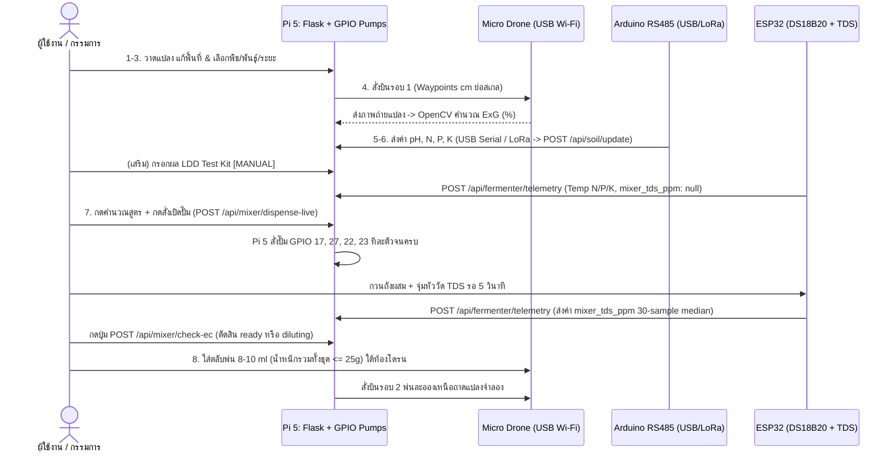

# System Overview & Master Plan: Smart Bio-Fert Drone System (Demo Scale)

- **เวอร์ชันเอกสาร:** `v1.6` (`2026-11-20`)
- **ลำดับความสำคัญเมื่อข้อมูลขัดกัน:** `03 (สูตร/API) > 02 (ฮาร์ดแวร์) > 04 (ขั้นตอนปฏิบัติ) > 01 (ภาพรวม)`
- **กฎเหล็กสำหรับ AI และทีม:** หากข้อมูลส่วนใดอยู่ในตาราง `TBD` หรือไม่ได้ระบุไว้ **ห้ามเดาหรือคิดเลขเองเด็ดขาด** ให้ใช้ค่า Placeholder ใน `config.py` และแจ้งหัวหน้าทีมเพื่อออกเวอร์ชันใหม่ (`v1.6`)

> **สถานะเอกสาร:** อัปเดตสถาปัตยกรรม **`v1.6`** ต่อยอดจากฮาร์ดแวร์เดิมใน `Back/` (`INEWGEN`): **`Raspberry Pi 5 (Flask/AI/Drone + คุมปั๊ม 4 ตัวตรง GPIO 17,27,22,23) + Arduino RS485 (หัววัดดิน USB/LoRa) + 1 ESP32 (แบบ B: DS18B20 3 ถัง + TDS/EC)`** ภายใต้งบส่วนต่อเติม (โดรน/ถังหมัก/TDS) ≤ **3,000 บาท** (ไม่รวมชุดปั๊ม+หัววัดดิน RS485 และ Raspberry Pi 5 / ESP32 ที่มีอยู่แล้ว)

---

## 1. แนวคิดหลักของโครงงานใหม่

ระบบบูรณาการการทำงานตั้งแต่ **การสำรวจแปลงบนแผนที่ดิจิทัล $\rightarrow$ การบินสำรวจภาพถ่ายทางอากาศ $\rightarrow$ การตรวจวัดธาตุอาหารในดิน $\rightarrow$ การหมักและผสมปุ๋ยน้ำชีวภาพสั่งตัดเฉพาะจุด $\rightarrow$ การบินโปรยปุ๋ยสาธิตด้วยโดรนขนาดเล็ก** เพื่อแก้ปัญหาต้นทุนปุ๋ยเคมีและการจัดการธาตุอาหารที่ไม่ตรงตามความต้องการจริงของพืช


1. **ปุ๋ยน้ำชีวภาพสั่งตัดเฉพาะจุด (Site-Specific Bio-Liquid Fertilizer):** เปลี่ยนจากการผสมแม่ปุ๋ยเคมี เป็นการใช้ **เครื่องหมักปุ๋ยน้ำชีวภาพ 3 ถังแยกธาตุ N, P, K** จากวัสดุท้องถิ่น แล้วผสมตามอัตราส่วนที่ดินขาดจริง
2. **Human-in-the-Loop Map Calibration:** ผู้ใช้ลากเส้นขอบเขตบนแผนที่ภาพถ่ายดาวเทียมฟรี (ไม่ต้องใช้บัตรเครดิต/API Key) เพื่อคำนวณพื้นที่อัตโนมัติ พร้อมเปิดให้ **ยืนยันหรือแก้ไขตัวเลขพื้นที่จริง** ก่อนส่งต่อให้ระบบคำนวณและย่อสเกลบิน
3. **Closed-Loop Safety (EC Check):** มีเซนเซอร์ตรวจสอบค่าการนำไฟฟ้า/สารละลายรวม (TDS/EC) ในถังผสมกลางก่อนนำขึ้นโดรน เพื่อคุมระดับความเค็มและป้องกันปัญหาน้ำปุ๋ยเข้มข้นเกินไปจนทำให้ใบพืชไหม้ (Salinity / Osmotic Burn Guard)
4. **Modular Micro-Drone:** ใช้โดรนขนาดเล็ก 1 ลำสลับภารกิจ 2 รอบ (รอบที่ 1 บินถ่ายภาพประเมินพื้นที่สีเขียว, รอบที่ 2 ติดตลับพ่นละอองฝอยขนาดจิ๋วพร้อมหัวฉีดรู 0.2–0.4 mm บินโปรยปุ๋ย) เพื่อให้บินในร่มบนโต๊ะเดโมได้อย่างปลอดภัยภายใต้งบจำกัด

---

## 2. สถาปัตยกรรมระบบ (System Architecture)

```text
+-----------------------------------------------------------------------------+
|       1. WEB, AI & MIXER CONTROLLER (Raspberry Pi 5 — Python Flask)         |
|  - Map UI (Leaflet + Esri Satellite): Draw Polygon -> Area (m^2)            |
|  - Crop DB (4 พืช 12 โปรไฟล์: ข้าว, ถั่วลิสง, ถั่วลายเสือ, ถั่วเหลือง)         |
|  - Image Analysis (OpenCV): ExG Green Index + Random Forest (R^2 = 0.9859) |
|  - Direct GPIO Pump Control (4x Peristaltic: GPIO 17, 27, 22, 23 Active-LOW)|
+-------+-----------------------------------+-----------------------------+---+
        | (USB Wi-Fi -> Drone)              | (USB Serial / LoRa)         | (HTTP Wi-Fi)
        v                                   ^                             ^
+---------------+               +-----------------------+     +-----------------------+
| 2. MICRO DRONE|               | 3. ARDUINO SOIL NODE  |     | 4. ESP32 FERMENTER    |
|    (Modular)  |               |   (Back/sketch.ino)   |     |    & TDS (แบบ B)      |
| Flight 1: Cam |               | - RS485 NPK + pH Probe|     | - 3x DS18B20 (GPIO 4) |
| Flight 2:     |               | - MAX485 (D3, D4, D5) |     | - TDS/EC Probe(GPIO35)|
| 8-10ml Spray  |               | - USB Serial / LoRa   |     | - Air Pump (Aerobic)  |
+---------------+               +-----------------------+     +-----------------------+
```

---

## 3. Workflow การทำงาน 8 ขั้นตอน (Demo Flow)

| ขั้นตอน | กิจกรรมหลัก | กลไกการทำงานและการเชื่อมข้อมูล |
| :---: | :--- | :--- |
| **1** | **เปิดเว็บแอปพลิเคชัน** | ผู้ใช้เปิดเบราว์เซอร์เข้าเว็บหลักที่รันบน **Raspberry Pi 5** (เชื่อม Wi-Fi 2 วง: วงที่ 1 สำหรับเน็ต/ESP32, วงที่ 2 USB Wi-Fi สำหรับโดรน) |
| **2** | **กำหนดขอบเขตแปลง & ยืนยันพื้นที่** | ลากเส้น Polygon บนแผนที่ดาวเทียม (Leaflet) $\rightarrow$ ระบบคำนวณพื้นที่ ($\text{m}^2$) $\rightarrow$ ผู้ใช้กด **ยืนยัน** หรือ **แก้ไขตัวเลขพื้นที่จริง** และตั้งค่าสเกลย่อส่วนสำหรับพื้นที่บินบนโต๊ะ |
| **3** | **กรอกข้อมูลพืชเป้าหมาย** | เลือก **ชนิดพืช** (ถั่วลิสงพันธุ์ลายเสือ / ข้าวโพดเลี้ยงสัตว์ / กาแฟอราบิก้า), **พันธุ์**, และ **ระยะการเจริญเติบโต** (ต้นกล้า / เจริญเติบโต / ออกดอก-ติดผล) |
| **4** | **โดรนรอบที่ 1: บินสำรวจถ่ายภาพ** | เว็บแปลงเส้นทางขอบเขตเป็นคำสั่งบินอัตโนมัติย่อสเกล (ระยะ $\text{cm}$ และมุมเลี้ยว) ส่งให้โดรนบินถ่ายภาพแปลงจำลอง $\rightarrow$ ส่งภาพกลับเข้าเว็บเพื่อคำนวณค่าพื้นที่สีเขียว (**ExG**) |
| **5–6** | **ตรวจค่าดินและเด้งเข้าเว็บทันที** | จิ้มหัววัดดิน **RS485 NPK+pH (`Arduino + MAX485`)** ลงถาดดินจริงจากแปลง ส่งค่าเข้า Pi 5 ผ่าน **USB Serial / LoRa** แบบเรียลไทม์ (`POST /api/soil/update`) และ/หรือบันทึกผล **LDD Soil Test Kit** คู่กัน |
| **7** | **คำนวณสูตร & สั่งเครื่องหมัก/ผสม** | เว็บเช็กอุณหภูมิ 3 ถังหมักจาก **ESP32** $\rightarrow$ คำนวณ $\Delta N, \Delta P, \Delta K$ (สมดุลมวล + Random Forest) $\rightarrow$ **Raspberry Pi 5 สั่งปั๊ม 4 ตัวตรงที่ GPIO 17, 27, 22, 23** (`POST /api/mixer/dispense-live`) $\rightarrow$ กวนและจุ่มหัววัด **TDS/EC (ESP32 GPIO 35)** ก่อนอนุญาตให้พ่น |
| **8** | **โดรนรอบที่ 2: เติมปุ๋ยและบินโปรย** | ถอดกล้อง/ปรับโหมดเป็นชุดพ่น Modular $\rightarrow$ ตักน้ำปุ๋ยที่ผสมเสร็จใส่ตลับสเปรย์ **8–10 ml** (น้ำหนักใช้งานจริง `22–23 g` ใต้เพดานสูงสุด `≤ 25 g`) $\rightarrow$ โดรนบินตามเส้นทางเดิมเหนือถาดแปลงจำลองพร้อมพ่นละอองฝอยสาธิต |

---

## 4. แผนพัฒนาและทดสอบ (Pre-work + 7-Day Build Plan)

- **Day 0 (Pre-work — เริ่มล่วงหน้า 3 สัปดาห์ก่อนพรีเซนต์):** ตั้งถังหมักปุ๋ยน้ำชีวภาพ 3 ถัง (N, P, K — เผื่อเวลาแช่กระดูกทำ WCP 7 วัน + หมักต่อ 7–14 วัน รวม 14–21 วัน) โดยใช้ปั๊มลมตู้ปลาแยกเติมอากาศไปก่อน แล้วค่อยนำมาติดเซนเซอร์เข้าระบบใน Day 3
- **Day 1 — โครงสร้างซอฟต์แวร์และฐานข้อมูล:** ตั้งค่าโปรเจกต์ Flask, สร้างตารางฐานข้อมูลพืช-พันธุ์-ระยะเติบโต (อ้างอิงเกณฑ์กรมวิชาการเกษตร) และเขียนฟังก์ชันคำนวณสูตรทั้ง 5 ชุดพร้อม Unit Test
- **Day 2 — ระบบแผนที่และแดชบอร์ด:** พัฒนาหน้าแผนที่ Leaflet (วาด Polygon + แก้พื้นที่ + ฟอร์มพืช) และหน้า Dashboard แสดงสถานะถังหมัก/ค่าดินแบบเรียลไทม์
- **Day 3 — เครื่องหมัก 3 ถัง + สถานีผสม:** ประกอบถังหมัก 3 ใบ, ปั๊มลม 3 หัวฟู่, เซนเซอร์อุณหภูมิ 3 ตัว, ปั๊มจุ่ม 4 ตัว (หุ้มตาข่ายกรอง 100–150 µm วางก้นถัง), รีเลย์ 4 ช่อง และ TDS/EC Probe พร้อม **สอบเทียบและหรี่วาล์วคุมอัตราการไหลของปั๊มทุกตัว (≤ 5–8 ml/s) และไล่น้ำเต็มท่อ**
- **Day 4 — ชุดตรวจดินและ API เชื่อมต่อ:** เขียนโค้ดบน **ESP32 ตัวเดียว** รวมทั้งฝั่งตรวจดิน (`GPIO 34`) และถังหมัก+เครื่องผสม (`GPIO 4, 35, 25, 26, 27, 33`) เชื่อม HTTP REST API กับ Flask Server บน Raspberry Pi 5 ให้ครบ
- **Day 5 — ระบบบินสำรวจ (โดรนรอบที่ 1):** ตั้งค่า USB Wi-Fi แยกวง, เขียนสคริปต์ควบคุมโดรนรับระยะย่อสเกลจากเว็บ บินถ่ายภาพส่งเข้า OpenCV คำนวณ ExG
- **Day 6 — ชุดพ่น Modular (โดรนรอบที่ 2):** ประกอบตลับพ่นละออง 0.2–0.4 mm + ปั๊มไมโคร 3V (คุมน้ำหนักใช้งานจริง `22–23 g`, เพดานสูงสุด `≤ 25 g`), ชั่งน้ำหนักและทดสอบจุดศูนย์ถ่วง, ซ้อมบินพ่นเหนือถาดรองน้ำ
- **Day 7 — ซ้อม End-to-End ครบ 8 ขั้นตอน:** ทดสอบรันระบบต่อเนื่องตั้งแต่ลากแผนที่จนถึงพ่นน้ำปุ๋ย โดยมีเกณฑ์ผ่าน (Pass Criteria): **อัตราไหลปั๊มคลาดเคลื่อน ≤ ±10%**, **น้ำหนักชุดพ่นรวมน้ำใช้งานจริง ≤ 22–23 g (มี margin ≥ 2 g ใต้เพดานสูงสุด 25 g)**, **ระบบ EC Dilution ลดความเค็มเข้าเกณฑ์ได้จริง**

---

## 5. คำถามที่พบบ่อย (FAQ) สำหรับเตรียมตอบกรรมการ

1. **ทำไมต้องให้ผู้ใช้แก้ไขค่าพื้นที่ที่คำนวณจากแผนที่ได้?**
   - เพราะภาพถ่ายดาวเทียมอาจมีขอบเขตที่ถูกเงาต้นไม้บังหรือความลาดชันบนดอยสูง ทำให้เส้นที่ลากคลาดเคลื่อนจากพื้นที่เพาะปลูกจริง การเปิดให้เกษตรกร/ผู้ใช้งานตรวจสอบและยืนยันหรือแก้ตัวเลขได้ ช่วยป้องกันการคำนวณปุ๋ยผิดพลาดทั้งแปลง
2. **ทำไมไม่ติดหัววัด NPK ลงบนตัวโดรนแล้วบินไปปักเอง?**
   - หัววัด NPK ชนิดแท่งเหล็กต้องใช้แรงกดแทงลงดินลึก 5–10 ซม. และหนักเกินกำลังยกของโดรนสาธิตขนาดเล็ก หากบินลงปักบนดินแข็งจะทำให้โดรนเสียการทรงตัวหรือใบพัดเสียหาย จึงออกแบบให้โดรนเน้นสำรวจและพ่น ส่วนการวัดดินใช้ชุดตรวจภาคพื้น/ถาดตัวอย่างเพื่อให้ได้ค่าที่เสถียรและปลอดภัยในสเกลเดโม (ในระดับอุตสาหกรรมจริงจะแยกเป็นโดรนสำรวจกับหุ่นยนต์ภาคพื้นหรือสถานีตรวจดินประจำแปลง)
3. **น้ำหมักชีวภาพมีตะกอน จะอุดตันหัวพ่นหรือไม่?**
   - ออกแบบให้ใช้ **ปั๊มจุ่ม 5V ที่หุ้มตาข่ายกรองละเอียด (≤ 100–150 µm) รอบตัวปั๊ม** วางก้นถังหมักแต่ละถัง และเลือกใช้ **หัวสเปรย์รูขนาด 0.2–0.4 mm (200–400 µm)** คู่ปั๊มไมโคร 3V แทนแผ่นตะแกรง Piezo (รู 5 µm) เพื่อให้อนุภาคที่ผ่านไส้กรองพ่นออกได้โดยไม่อุดตัน รวมถึงหมักแบบเติมอากาศ (Aerobic) เพื่อลดตะกอนและกลิ่น
4. **จะมั่นใจได้อย่างไรว่าปุ๋ยที่ผสมไม่เข้มข้นเกินไปจนต้นไม้ตาย?**
   - ระบบมีเซนเซอร์ **TDS/EC** ตรวจสอบระดับเกลือ/แร่ธาตุละลายรวมในถังผสมกลางหลังผสมเสร็จ (Salinity/Osmotic Burn Guard) โดยผู้ใช้กวนถังและจุ่มหัววัดอ่านค่า หากค่าเกินเกณฑ์ปลอดภัยของพืชในระยะนั้น ระบบจะคำนวณปริมาตรน้ำและสั่งปั๊มตัวที่ 4 เติมน้ำเปล่าเจือจางให้โดยอัตโนมัติ (หมายเหตุ: TDS/EC ใช้วัดความเค็มรวมเพื่อกันใบไหม้ ไม่ใช่วัดปริมาณไนโตรเจนอินทรีย์โดยตรง)

---

## 6. ข้อกำหนดกลางป้องกันการเดาของ AI (Central Ground Truth Contract)

> **สำคัญสำหรับเพื่อนทุกคนที่ใช้ AI ช่วยเขียนโค้ดหรือสรุปข้อมูล:** ให้นำกติกา 8 ข้อนี้ไปใส่เป็นบริบทให้ AI ทุกครั้ง ห้าม AI เปลี่ยนสถาปัตยกรรมหรือคิดโปรโตคอลใหม่เอง

1. **โปรโตคอลสื่อสารกลาง:** ใช้ **HTTP/1.1 REST JSON** บน Flask พอร์ต `5000` สำหรับการสื่อสาร `Web ↔ ESP32` และ `Frontend ↔ Flask` (**ไม่ใช้ MQTT, WebSocket, Firebase**) ส่วน `Flask ↔ โดรน` ใช้ **SDK ของโดรน (UDP/TCP)**
2. **คลื่น Wi-Fi:** บอร์ด ESP32 รองรับเฉพาะ **Wi-Fi 2.4 GHz เท่านั้น** (ห้ามต่อ Hotspot 5 GHz)
3. **ระบบแผนที่:** ใช้ **Leaflet.js + Esri World Imagery** (ฟรี ไม่ต้องใช้ Google Maps API Key และไม่ผูกบัตรเครดิต)
4. **ข้อจำกัดขา Analog ของ ESP32:** เมื่อเปิด Wi-Fi ห้ามใช้ขา `ADC2` ให้ใช้เฉพาะขา **`ADC1` (`GPIO 32, 33, 34, 35, 36, 39`)** สำหรับเซนเซอร์ Analog ทุกตัว
5. **หัวพ่นโดรน:** ใช้ **Micro Spray Nozzle รู 0.2–0.4 mm + ปั๊มไมโคร 3V** เติมน้ำปุ๋ย **8–10 ml** โดย **น้ำหนักรวมทั้งชุดพ่น (รวมน้ำ, ปั๊ม, แบต, ตลับ, หัวพ่น, ท่อ) ≤ 25 กรัม** (**ห้ามใช้แผ่น Piezo 5 µm** เพราะน้ำหมักจะอุดตันทันที)
6. **สูตรปุ๋ยหมักถัง P-Bio:** ใช้ **กระดูกสัตว์คั่ว/ป่นแช่น้ำส้มสายชู (WCP) + รำละเอียด** (**ห้ามใช้เปลือกไข่** เป็นแหล่งฟอสฟอรัสเพราะเปลือกไข่ให้แคลเซียม WCA)
7. **ขอบเขตงานโดรน:** ใช้โดรนขนาดเล็กบินในร่มบนถาดแปลง `60 × 80 cm` (กรอบบินปลอดภัย **`40 × 60 cm`** หักขอบด้านละ 10 cm) ด้วย Optical Flow โดย**ไม่ติดหัววัดดินบนตัวโดรน** (หัววัดดินจิ้มบนถาดตัวอย่างบนโต๊ะแทน)
8. **การแยกแหล่งข้อมูล (Data Provenance):** ระบบต้องแยกระหว่าง `LIVE` (อุปกรณ์จริง), `SIMULATED` (ข้อมูลจำลองทดสอบ), `MANUAL` (ผู้ใช้กรอก), `CALCULATED` (ผลคำนวณ), `STALE` (ข้อมูลเก่า), และ `NO DATA` — ข้อมูลจำลองทุกชนิดต้องส่ง `"simulated": true` ห้ามปลอมเป็นข้อมูลจริง

### แผนภาพลำดับการทำงานระหว่างอุปกรณ์ (End-to-End Sequence)



---

## 7. ตารางค่าที่ยังไม่รู้ ห้ามเดา (TBD — To Be Determined)

> **คำสั่งสำหรับ AI ผู้ช่วยของทีม:** ห้ามแต่งตัวเลขแทนค่าในตารางนี้ ให้ใช้ค่า Placeholder ที่ระบุไว้ชั่วคราวแล้วรอค่าจริงจากผู้รับผิดชอบ

| ค่าที่ยังไม่ทราบ | ผู้รับผิดชอบวัดจริง | ค่าที่ล็อกไว้แล้ว / Placeholder ระหว่างรอ |
| :--- | :---: | :--- |
| `Q_pump` ทั้ง 4 ตัว (`ml/s`) | สอบเทียบแล้วใน `Back/` | **วัดจริงแล้ว:** `N=3.03`, `P=2.00`, `K=6.40`, `W=22.08 ml/s` (ใส่ใน `config.py` แล้ว) |
| 64-bit ROM Address ของ DS18B20 ทั้ง 3 ตัว (ถัง N, P, K) | คนที่ 2 | ยังไม่มี (ต้องอ่านจาก Serial Monitor ก่อนใช้จริง) |
| ตัวคูณสอบเทียบ TDS (`K_cal`) | คนที่ 2 | `1.0` |
| TDS ของน้ำเปล่าที่ใช้เจือจาง (`water_tds_ppm`) | คนที่ 2 | `150.0 ppm` |
| ความเข้มข้นน้ำหมัก `C_bio` (N, P₂O₅, K₂O หน่วย `mg/ml`) | คนที่ 4 (ถ้าส่งแล็บ) | `2.0 mg/ml` เท่ากันทั้ง 3 ถัง *(ในระดับ Demo ใช้ค่านี้ได้เลยไม่ต้องวัดเอง เพื่อรักษาสัดส่วน $\Delta M$ เว้นแต่ส่งตรวจห้องแล็บจริง)* |
| รุ่นโดรน, ไลบรารี SDK, ระยะสั่งบินขั้นต่ำ | คนที่ 3 | ใช้โหมด `SIMULATED` เท่านั้นจนกว่าจะได้รุ่นโดรน |
| อัตราพ่นของตลับ (`ml/s`) และน้ำหนักบรรทุกจริง | คนที่ 3 | ยังไม่มี (ต้องทดสอบจริงใน Day 6) |
| ค่าเป้าหมายพืช 4 ชนิด (12 โปรไฟล์) | คนที่ 1 & คนที่ 4 | ใช้ตารางอ้างอิงกรมการข้าว/DOA ใน `database.py` และ `03` (`v1.6`) |
